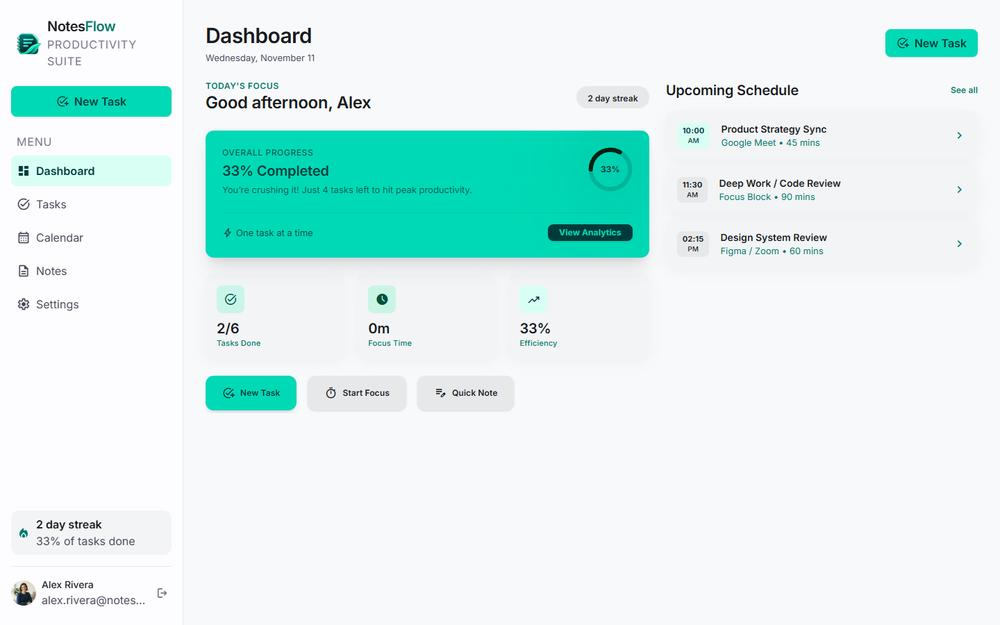
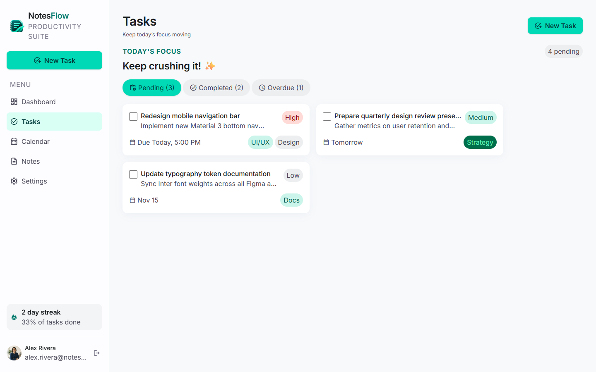
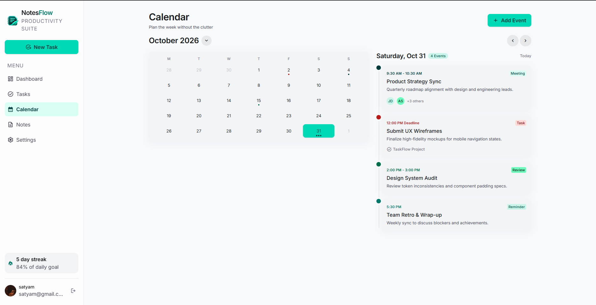
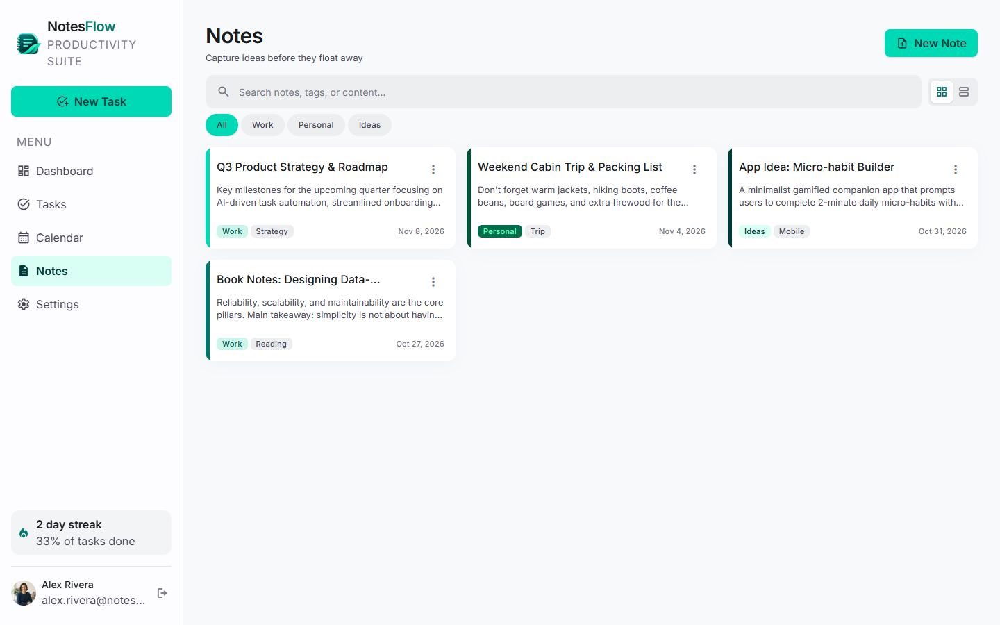
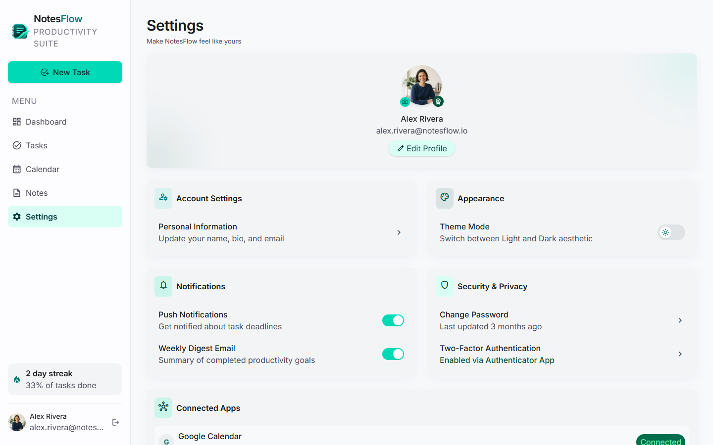

# NotesFlow — Notes Management & Productivity Suite

A modern productivity application designed to help users organize their notes, manage daily tasks, schedule events, and improve their productivity through a clean and intuitive interface.

## 🚀 Features

- **Dashboard:** Track daily goals, productivity statistics, and upcoming schedules.
- **Task Management:** Create, organize, prioritize, and track tasks.
- **Calendar:** Manage events and visualize your schedule.
- **Notes Management:** Create, organize, search, and categorize notes.
- **Settings:** Customize account information, appearance, notifications, and privacy preferences.
- **Focus Tracking:** Monitor focus sessions and productivity streaks.
- **Responsive UI:** Clean and modern interface.

## 🖥️ Screenshots

### Dashboard


### Task Management


### Calendar


### Notes Management


### Settings


## 🛠️ Technologies Used

- React.js
- JavaScript
- HTML5
- CSS3
- Vite

## ⚙️ Installation and Setup

1. Clone the repository:

   ```bash
   git clone https://github.com/Satyam-IN/NotesFlow.git
   ```

2. Navigate to the project directory:

   ```bash
   cd NotesFlow
   ```

3. Install dependencies:

   ```bash
   npm install
   ```

4. Start the development server:

   ```bash
   npm run dev
   ```

5. Open the local URL displayed in your terminal.

## 📂 Project Structure

```text
NotesFlow/
├── public/
├── src/
│   ├── components/
│   ├── data/
│   ├── hooks/
│   ├── pages/
│   ├── store/
│   └── utils/
├── screenshots/
├── index.html
├── package.json
└── vite.config.js
```

## 🔮 Future Improvements

- Cloud synchronization
- AI-powered note organization
- Advanced productivity analytics
- Improved notification and reminder system
- Additional integrations

## 👨‍💻 Developer

**Satyam Kumar Jha**

GitHub: [@Satyam-IN](https://github.com/Satyam-IN)

## 📜 License

This project is available for educational and portfolio purposes.
